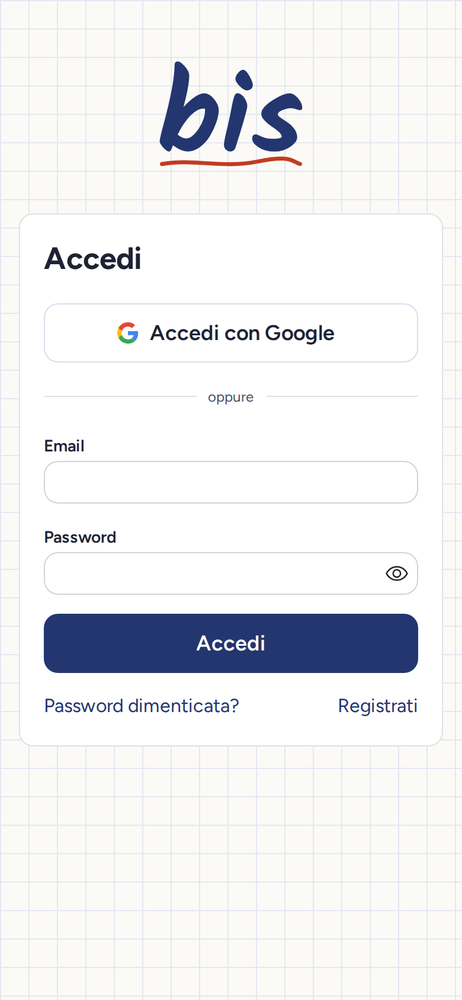
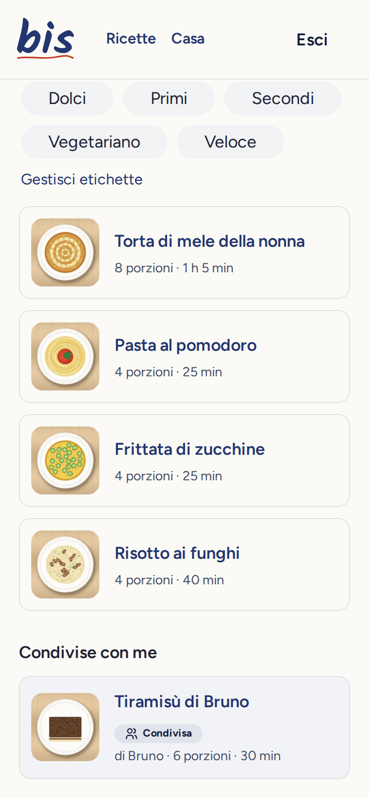
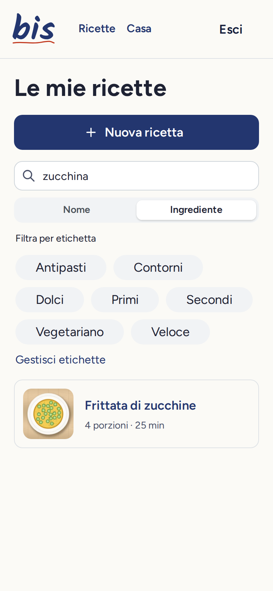
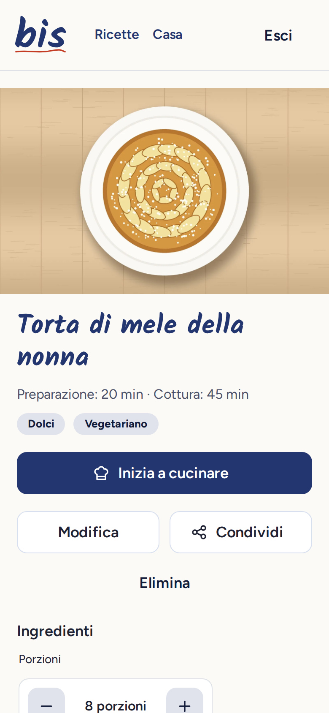
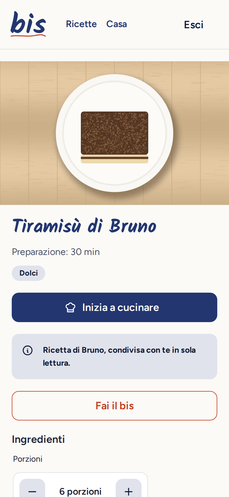
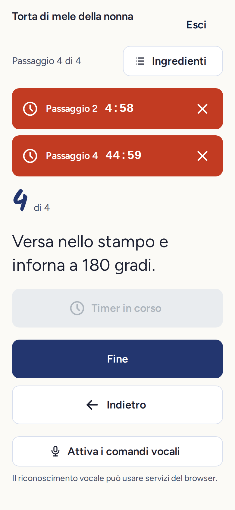

# Bis

*A mobile-first recipe notebook for households.*

[](https://github.com/elisanembrini/bis/actions/workflows/ci.yml)

Bis is a household recipe book designed for the phone. It grew out of the notebook where you write down the recipes that turned out well: it keeps your own version of a dish, helps you find it in seconds, and lets you follow it in the kitchen with your hands full.

It is used by a small group of people who live in the same home. Everyone has their own recipe book and decides what to share, and with whom. The interface is in Italian by default and is ready for more languages: all texts, formats and voice-command phrases live in per-language i18next resources.

## Screenshots

The interface is in Italian. The screenshots are taken on a phone-sized screen, with sample data and illustrations in place of photos.

<table>
  <tr>
    <td align="center" valign="top">
      <br>
      <sub>Sign-in, on the notebook grid</sub>
    </td>
    <td align="center" valign="top">
      <br>
      <sub>Recipe list: your own recipes and the ones shared with you</sub>
    </td>
    <td align="center" valign="top">
      <br>
      <sub>Search by ingredient: "zucchina" finds "zucchine"</sub>
    </td>
  </tr>
  <tr>
    <td align="center" valign="top">
      <br>
      <sub>Recipe detail, with servings that recalculate the quantities</sub>
    </td>
    <td align="center" valign="top">
      <br>
      <sub>A shared recipe: read-only, with "Fai il bis" to make your own copy</sub>
    </td>
    <td align="center" valign="top">
      <br>
      <sub>Cooking mode: one step at a time, several timers at once</sub>
    </td>
  </tr>
</table>

## Features

- **Sign-in**: email and password, or Google (OAuth flow handled by the backend, with `state` and PKCE). Server-side sessions with httpOnly cookies, login rate limiting, password recovery by email.
- **Household and invitations**: single-use invitation links valid for 7 days, member list, leaving the household and removing members.
- **Recipes**: ingredients with decimal quantities written the Italian way (and "q.b.", short for *quanto basta*, "as needed"), steps with timers, photos of the dish and of each step, and an optional link to the page the recipe was taken from. Photos are processed on the server: orientation fixed, all metadata (including GPS location) stripped, converted to WebP, thumbnails generated.
- **Tags and search**: search by name and by ingredient using PostgreSQL full-text search configured for Italian. "Zucchina" finds "zucchine" (singular and plural match), ignoring case and accents, and it works with incomplete words while typing.
- **Servings**: quantities are recalculated in the view only, with readable rounding per unit.
- **Sharing and copying**: a recipe can be shared with household members, who see it read-only. With "Fai il bis" (roughly "have seconds") each of them makes an independent copy, photos included.
- **Recipe import (optional)**: paste the text of a recipe or a link and a language model fills the form for you to review. It talks to any OpenAI-compatible API (Ollama locally or a hosted provider), constrains the answer to a JSON schema and validates it, downloads links only from public addresses and limits imports per person. Without a model configured the feature is simply absent. See [Recipe import](#recipe-import).
- **Installable app**: web manifest and icons, an install banner (native prompt where available, manual instructions on iOS) and a hand-written service worker that caches static assets and shows an offline page. API responses are never cached, and using recipes offline is not supported yet.
- **Cooking mode**: one step at a time with large text, screen kept awake, several timers running at once (computed from the end time, so they stay accurate even with the tab in the background) and voice commands in Italian: "avanti" (next), "indietro" (back), "ripeti" (repeat), "avvia timer" (start timer).

### Status

Features F1 to F10 of the specification are implemented. The app has not been deployed to production yet.

## Stack

| Area | Tools |
| --- | --- |
| Backend | Python 3.12, FastAPI, SQLAlchemy 2, Alembic, PostgreSQL, Pydantic v2, managed with uv |
| Frontend | React with React Compiler, Vite, strict TypeScript, TanStack Router and Query, Zustand, Mantine, i18next, managed with pnpm |
| Quality | Ruff and mypy (strict), Oxlint (type-aware) and Oxfmt, pytest on a real PostgreSQL, Vitest, Storybook, Playwright |
| Tooling | Docker and Docker Compose |

The API contract is the OpenAPI schema generated by the backend (`openapi.json`, versioned). The TypeScript types of the client are generated from it, so an API change that breaks the frontend fails the type check.

## Quick start

You need Docker and Docker Compose.

```bash
cp .env.example .env
docker compose up -d --build
```

| Service | Address |
| --- | --- |
| App | http://localhost:5173 |
| API documentation | http://localhost:8000/docs |
| Mailpit (development emails, such as password recovery) | http://localhost:8025 |

Migrations are applied when the backend starts. If a port is already in use, change it in the `.env` file.

Google sign-in is optional. To enable it, set `GOOGLE_CLIENT_ID` and `GOOGLE_CLIENT_SECRET` in the `.env` file and register `http://localhost:5173/api/auth/google/callback` as an authorized redirect URI in the Google console.

## Development and tests

You also need Node 24, pnpm 11 and uv (which installs Python 3.12).

**Backend**, from `apps/backend`. Tests use the PostgreSQL started by `docker compose` and read their configuration from `.env`:

```bash
cp .env.example .env
uv sync
uv run pytest
uv run ruff check . && uv run ruff format --check . && uv run mypy .
uv run alembic upgrade head
uv run python -m scripts.export_openapi   # updates openapi.json in the root
```

**Frontend**, from `apps/frontend` (run `pnpm install` once from the root):

```bash
pnpm lint
pnpm format:check
pnpm typecheck
pnpm test             # Vitest, including the Storybook stories (needs Chromium)
pnpm storybook
pnpm generate:api     # regenerates the types from openapi.json
```

**End to end**, from the root. Install the browser the first time; after that the tests start the stack if it is not already running. The service worker tests run against a production build served by `vite preview` on port 4173, which the test run builds and starts by itself (set `API_PROXY_TARGET` if the API is not on port 8000):

```bash
pnpm --filter bis-e2e exec playwright install chromium
pnpm test:e2e
```

## Deployment

The production setup (Docker Compose with Caddy and automatic HTTPS, nightly encrypted backups, one-command releases) is in `docker-compose.prod.yml` and `deploy/`. [docs/DEPLOY.md](docs/DEPLOY.md) is the step-by-step guide: preparing an Ubuntu 24.04 server, the first release, later releases, restoring from a backup and what to do when a release goes wrong.

To run Bis for free on your own Mac, reachable only from your devices through Tailscale, use the home profile instead: [docs/CASA.md](docs/CASA.md).

## Recipe import

The import is optional and needs a language model reachable through an OpenAI-compatible chat completions API. Set these variables in `.env`:

| Variable | Meaning |
| --- | --- |
| `LLM_BASE_URL` | Base URL of the API, for example `http://localhost:11434/v1` for Ollama |
| `LLM_MODEL` | Model name, for example `llama3.2:3b` |
| `LLM_API_KEY` | Only for hosted providers |

Inside Docker, `localhost` is the container itself: point `LLM_BASE_URL` at an address the backend container can reach (for example the host IP or a Tailscale address).

Quality is measured, not assumed. `apps/backend/evals/recipe_import_cases.json` holds Italian recipe texts with the expected title, ingredients, quantities, units, steps, timers and servings (and one text that is not a recipe). Run the evaluation against the configured model from `apps/backend`:

```bash
uv run python -m scripts.evaluate_import
```

It prints a score per case and the mean (recipe detection, title, ingredient recall, quantity and unit accuracy, number of steps, timers, servings and seconds per case). The tests use a fake model, so they never call a real one.

## Continuous integration

GitHub Actions runs the same checks described above (`.github/workflows/ci.yml`). Every push to `main` and every pull request runs the backend job (Ruff, mypy, pytest on PostgreSQL 18), the frontend job (Oxlint, Oxfmt, type check, Vitest with the Storybook stories, production and Storybook builds) and an API contract job that fails when `openapi.json` or the generated TypeScript types are out of date, and a production setup job (ShellCheck on the deploy scripts, validation of `docker-compose.prod.yml` and build of the production images). The end-to-end tests run only on pushes to `main`.

## Structure

```
apps/backend/      FastAPI API: routers, services, repositories, models, schemas, Alembic migrations, tests
apps/frontend/     React app: routes, features, shared components, typed client, Storybook
e2e/               Playwright tests
docs/              product specification and visual identity
openapi.json       API schema exported by the backend
docker-compose.yml
```

The backend is layered (thin routes, business logic in services, data access in repositories) and every authorization is checked on the server, on every endpoint. The frontend is organized by feature, with tests and stories next to the code they cover.

## Documentation

- [`docs/SPEC.md`](docs/SPEC.md): product specification, with acceptance criteria, data model and API.
- [`docs/DESIGN.md`](docs/DESIGN.md): the "Quaderno" visual identity.

## Development approach

The project started from a product specification and a set of project rules written before the code. Work proceeded one functional stage at a time: each stage was planned and approved first, then implemented, and closed only with lint, type checks and tests all passing. The visual identity was applied in a dedicated stage.

## License

[MIT](LICENSE).
